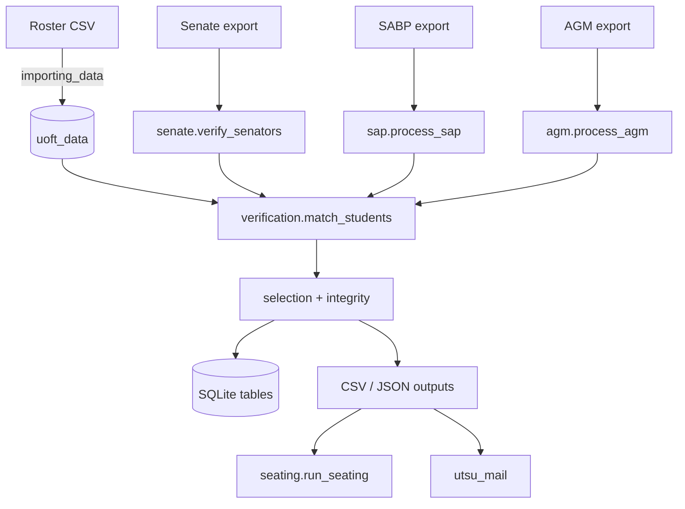

# Architecture

## Packages

| Package | Module | Responsibility |
|---|---|---|
| `utsu_core` | `main.py` | CLI entry point, config merge, testing mode, dispatch of programs and one-off actions |
| | `importing_data.py` | Roster CSV → validated rows → `uoft_data` in one transaction |
| | `verification.py` | `decide` / `match_students` (the matching rules); lookup-table reader `setup_reader` |
| | `selection.py` | Timestamp parsing, `person_key`, one-binding-per-person selection (`select_current`) |
| | `integrity.py` | Duplicate detection, alerts |
| | `pipeline.py` | `Run`: the steps Senate, SABP and AGM share (remembered verification, selection, saving, statuses, alerts, run counts) |
| | `senate.py`, `seating.py` | Senate verification; seat assignment |
| | `sap.py`, `wfni.py` | SABP pipeline, batches, reviews, decisions; WFNI scoring |
| | `agm.py` | AGM RSVP processing, verification, lists (and the standalone verification report) |
| `utsu_std` | `utils.py` | Logging setup, config load/save/merge, ASCII cleaning, typed ids, project-root paths |
| | `database.py` | Connection, consistent backups |
| | `csv_safe.py` | Encoding-tolerant reading, formula-safe writing (`write_rows`) |
| | `parsing_utils.py` | Student-number and division helpers |
| `utsu_mail` | `__main__.py` | Mail-merge CLI |
| | `templates.py`, `recipients.py`, `schema.py` | Template parsing/rendering, recipients and validity, schema introspection |
| | `campaign.py`, `transport.py` | Preview/confirm/send/log; SMTP and message building |
| | `notices.py` | Builds recipient files for rejections and more-info requests |

## Data flow

## The common per-program pipeline

`senate.py`, `sap.py` and `agm.py` follow the same shape, and the shared steps are code in `pipeline.py` (the `Run`
class: `Run(...)`, `keep_verified`, `select`, `replace_all`, `settle`, `alert`, `summary`), so the three programs cannot
drift apart. Every run reads the **full** export:

1. **Read** the export with `setup_reader` (renames columns by the lookup table), build one dict per row, compute `uuid`
   and `student_uuid`, and de-duplicate by `uuid` (last row wins). `Run(...)` also reads which applications an earlier
   run verified (Senate and SABP; AGM is not sticky).
2. **Verify** every row (`match_students` in chunks of 300), then `keep_verified`: an application verified before is
   never downgraded (it is raised as a `roster_mismatch` alert).
3. **Select** one binding application per person (`select_current`: grouped by email, else student number, else name,
   ordered by submission timestamp; these are the defaults of `Run`), assigning `superseded`, `non_binding` or
   `not_considered` to the others. SABP's `key` adds the term, marks an already-decided application `final`, and passes
   the stored applications that are no longer in the export (`absent`) so they compete too.
4. **Persist**: Senate and AGM rebuild their table from the export (`replace_all`); SABP upserts, never deleting the
   committee's work. Statuses of stored rows that lost are recorded in `settle`, which also checks duplicates.
5. **Write** the CSV/JSON outputs and the alerts.

## Design decisions worth knowing

- **Idempotent and deterministic.** Ids come from content (UUIDv5), seating from a seed, so re-runs reproduce results.
- **Plain SQLite and CSV.** No services; the database is a single file that is backed up before each run.
- **ASCII normalization** makes matching tolerant of accents and look-alike characters (documented, deliberate).
- **Config in a project-root-relative world.** `absfile` resolves everything from the folder holding `pyproject.toml`
  (or an enclosing `src` folder), which is why an editable install is required.
- **Fail-safe outputs.** Anything a person opens in a spreadsheet goes through `SafeDictWriter` / `SafeWriter`.
- **Human in the loop** at the high-impact points: alerts, reviewer sheets, decisions, and the `send`
  confirmation for email.

## Extending

- **A new form/program**: add `data/conversion_table_<x>.csv`, a table in `src/schema/<x>.sql`, a module that builds its
  rows and uses `pipeline.Run` (see `agm.py`, the shortest), and a dispatch branch in `main.py`.
- **A new email**: drop `templates/email/<name>.txt`; check columns with `python -m utsu_mail --list_fields <name>`.
- **A new SABP question**: add the form heading to `conversion_table_sap.csv`, add the question to `QUESTIONS` in
  `wfni.py` and rows to `wfni_weights.csv`.
