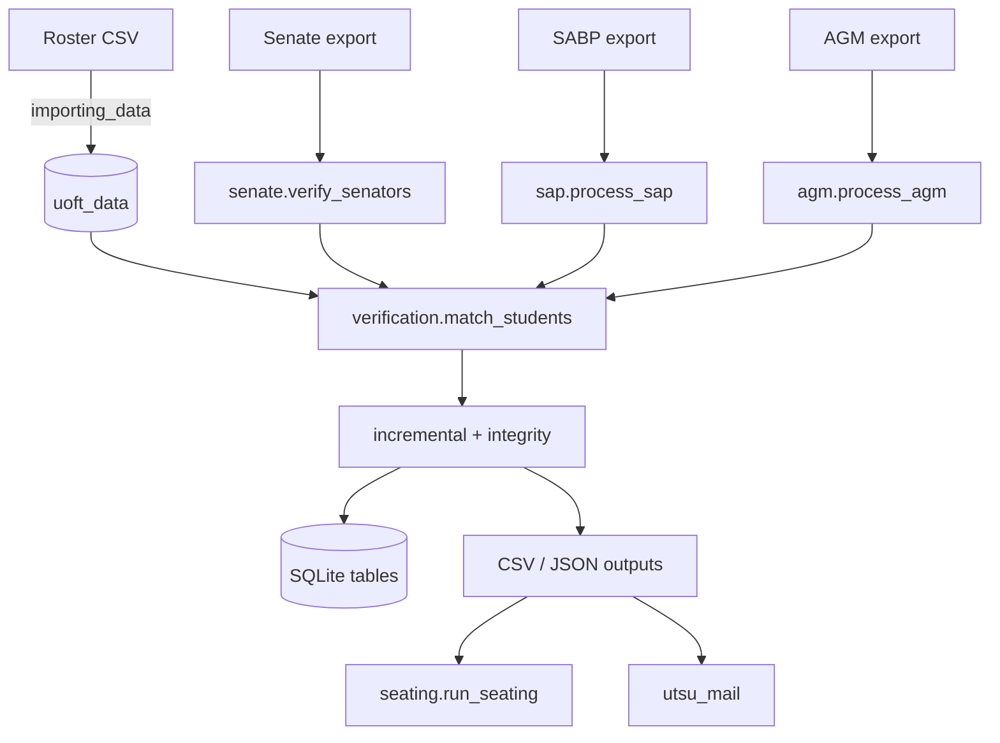

# Architecture

## Packages

| Package | Module | Responsibility |
|---|---|---|
| `utsu_core` | `main.py` | CLI entry point, config merge, testing mode, dispatch of programs and one-off actions |
| | `importing_data.py` | Roster CSV → cleaned CSV → `uoft_data` |
| | `verification.py` | `decide` / `match_students` (the matching rules); lookup-table reader `setup_reader` |
| | `incremental.py` | Row fingerprints, known-row reuse, timestamp parsing, `person_key`, one-binding-per-person selection (`select_current`) |
| | `integrity.py` | Invalid/held rows, duplicate detection, alerts |
| | `pipeline.py` | `Run`: the steps Senate, SABP and AGM share (known rows, integrity, selection, statuses, alerts, run counts) |
| | `senate.py`, `seating.py` | Senate verification; seat assignment |
| | `sap.py`, `wfni.py` | SABP pipeline, batches, reviews, decisions; WFNI scoring |
| | `agm.py` | AGM RSVP processing, verification, lists (and the standalone verification report) |
| `utsu_std` | `utils.py` | Logging setup, config load/save/merge, ASCII cleaning, typed ids, project-root paths |
| | `database.py` | Connection, consistent backups, CSV import helper |
| | `csv_safe.py` | Encoding-tolerant reading, formula-safe writing (`write_rows`) |
| | `parsing_utils.py` | Student-number and division helpers |
| `utsu_mail` | `__main__.py` | Mail-merge CLI |
| | `templates.py`, `recipients.py`, `schema.py` | Template parsing/rendering, recipients and validity, schema introspection |
| | `campaign.py`, `transport.py` | Preview/confirm/send/log; SMTP and message building |
| | `notices.py` | Builds recipient files for rejections and more-info requests |

## Data flow

## The common per-program pipeline

`senate.py`, `sap.py` and `agm.py` follow the same shape, and steps 2, 3, 5 and 6 are shared code in `pipeline.py` (the
`Run` class: `Run(...)`, `select`, `to_save`, `settle`, `alert`, `summary`), so the three programs cannot drift apart:

1. **Read** the export with `setup_reader` (renames columns by the lookup table), build one dict per row, compute `uuid`,
   `student_uuid` and `source_hash`, and de-duplicate by `uuid` (last row wins).
2. **Known rows**: load what the database already has (`known_rows`) and `apply_known` to copy stored outcomes onto
   rows already processed, returning only those that need (re)verification.
3. **Integrity**: `changed_after_processing` marks locked rows whose form row changed; `restored_after_processing`
   releases holds where the row is back to normal.
4. **Verify** only the rows that need it (`match_students` in chunks of 300).
5. **Select** one binding application per person (`select_current`: grouped by email, else student number, else name,
   ordered by submission timestamp; these are the defaults of `Run`), assigning `superseded`, `non_binding` or
   `not_considered` to the others. A program with extra rules passes a callback: SABP's `set_aside` (in `sap.py`) marks
   an already-completed application `final` and sets the student's other applications for that term aside before
   verification, and SABP's `key` adds the term.
6. **Persist** with an upsert, record statuses and invalid flags, check duplicates.
7. **Hold** invalid rows out of the outputs, **write** the CSV/JSON outputs and alerts.

## Design decisions worth knowing

- **Idempotent and deterministic.** Ids come from content (UUIDv5), seating from a seed, so re-runs reproduce results.
- **Plain SQLite and CSV.** No services; the database is a single file that is backed up before each run.
- **ASCII normalization** makes matching tolerant of accents and look-alike characters (documented, deliberate).
- **Config in a project-root-relative world.** `absfile` resolves everything from the folder holding `pyproject.toml`
  (or an enclosing `src` folder), which is why an editable install is required.
- **Fail-safe outputs.** Anything a person opens in a spreadsheet goes through `SafeDictWriter` / `SafeWriter`.
- **Human in the loop** at the high-impact points: held applications, reviewer sheets, decisions, and the `send`
  confirmation for email.

## Extending

- **A new form/program**: add `data/conversion_table_<x>.csv`, a table in `src/schema/<x>.sql`, a module that builds its
  rows and uses `pipeline.Run` (see `agm.py`, the shortest), a dispatch branch in `main.py`, and add the table to
  `TABLES` in `integrity.py`.
- **A new email**: drop `templates/email/<name>.txt`; check columns with `python -m utsu_mail --list_fields <name>`.
- **A new SABP question**: add the form heading to `conversion_table_sap.csv`, add the question to `QUESTIONS` in
  `wfni.py` and rows to `wfni_weights.csv`.
