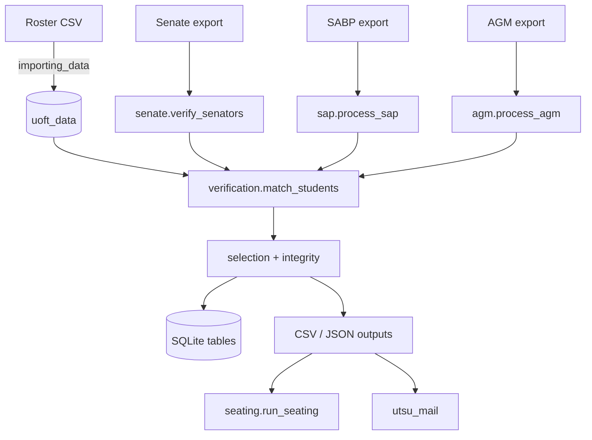

# Architecture

## Packages

| Package | Module | Responsibility |
|---|---|---|
| `utsu_core` | `spec.py` | `ProgramSpec`: the declarative description of a program (form lookup table, table and schema, identity columns, key/rank, hooks) |
| | `pipeline.py` | `Run`: the engine that runs any `ProgramSpec` (read, verify, remembered verification, selection, saving, statuses, alerts, run counts) |
| | `cli.py` | `ProgramCli`, common flags, config merge, testing mode, roster import, `execute` / `cli_main` |
| | `importing_data.py` | Roster CSV → validated rows → `uoft_data` in one transaction (schema in `schema/uoft_data.sql`) |
| | `verification.py` | `decide` / `match_students` (the matching rules); `setup_reader`; `is_uoft_email`; `truncated_numbers` |
| | `selection.py` | Timestamp parsing, `person_key`, one-binding-per-person selection (`select_current`) |
| | `integrity.py` | Duplicate detection, alerts |
| | `resources.py` | Reads the schema files that ship inside a package |
| `utsu_programs` | `runner.py` | `utsu-all`: Senate, SABP and AGM in one run |
| | `senate/` | `program.py` (spec, `verify_senators`), `seating.py` (seat assignment), `cli.py` (`utsu-senate`), `schema.sql` |
| | `sap/` | `program.py` (spec, batches, reviews, decisions), `wfni.py` (WFNI scoring), `cli.py` (`utsu-sap`), `schema.sql` |
| | `agm/` | `program.py` (spec, RSVP processing, lists, verification report), `cli.py` (`utsu-agm`), `schema.sql` |
| `utsu_std` | `utils.py` | Logging setup, config load/save/merge, ASCII cleaning, typed ids, project-root paths |
| | `database.py` | Connection, consistent backups |
| | `csv_safe.py` | Encoding-tolerant reading, formula-safe writing (`write_rows`) |
| | `parsing_utils.py` | Student-number and division helpers |
| `utsu_mail` | `__main__.py` | Mail-merge CLI |
| | `templates.py`, `recipients.py`, `schema.py` | Template parsing/rendering, recipients and validity, schema introspection |
| | `campaign.py`, `transport.py` | Preview/confirm/send/log; SMTP and message building |
| | `notices.py` | Builds recipient files for rejections and more-info requests |

Dependencies point one way: a program imports `utsu_core` and `utsu_std`, never another program, and `utsu_core` never
imports a program (`tests/test_programs.py` checks both). Each program is therefore a unit that can be packaged as its
own application; `pyproject.toml` installs one command per program (`utsu-senate`, `utsu-sap`, `utsu-agm`) and
`utsu-all`.

## Data flow

## The common per-program pipeline

A program is declared as a `ProgramSpec` (`utsu_core/spec.py`) in its `program.py`, and the shared engine in
`utsu_core/pipeline.py` (the `Run` class: `Run.start`, `verify`, `select`, `replace_all`, `settle`, `alert`, `summary`)
runs it, so the three programs cannot drift apart. What a program supplies itself are hooks: `build_row` (a form row →
a row), `annotate` (what else it records about a verification), `veto` (a rule that overrides the roster, e.g. the AGM's
email rule), `prepare` (stored rows that compete, for SABP) and what it writes afterwards. Every run reads the **full**
export:

1. **Read** (`Run.start`) the export with `setup_reader` (renames columns by the spec's lookup table), build one dict per
   row with the spec's `build_row`, compute `uuid` and `student_uuid`, and de-duplicate by `uuid` (last row wins).
   `Run` also reads which applications an earlier run verified (`sticky` specs: Senate and SABP; AGM is not sticky).
2. **Verify** (`Run.verify`) every row (`match_students` in chunks of 300, using the spec's `id_key`), then keep what an
   earlier run verified: an application verified before is never downgraded (it is raised as a `roster_mismatch` alert).
3. **Select** one binding application per person (`select_current`: grouped by the spec's `key`, by default email, else
   student number, else name, ordered by its `rank`, by default the submission timestamp), assigning `superseded`,
   `non_binding` or `not_considered` to the others. SABP's `key` adds the term, marks an already-decided application
   `final`, and passes the stored applications that are no longer in the export (`absent`, from its `prepare`) so they
   compete too.
4. **Persist**: Senate and AGM rebuild their table from the export (`replace_all`, with the spec's `insert`); SABP upserts,
   never deleting the committee's work. Statuses of stored rows that lost are recorded in `settle`, which also checks
   duplicates.
5. **Write** the CSV/JSON outputs and the alerts.

## Design decisions worth knowing

- **Idempotent and deterministic.** Ids come from content (UUIDv5), seating from a seed, so re-runs reproduce results.
- **Plain SQLite and CSV.** No services; the database is a single file that is backed up before each run.
- **ASCII normalization** makes matching tolerant of accents and look-alike characters (documented, deliberate).
- **Config in a project-root-relative world.** `absfile` resolves the editable data (`data/`, `templates/`, `secrets/`)
  from the folder holding `pyproject.toml` (or an enclosing `src` folder), which is why an editable install is required.
  SQL schemas are not part of that: they ship inside their package and are read through `utsu_core.resources`.
- **Fail-safe outputs.** Anything a person opens in a spreadsheet goes through `SafeDictWriter` / `SafeWriter`.
- **Human in the loop** at the high-impact points: alerts, reviewer sheets, decisions, and the `send`
  confirmation for email.

## Extending

- **A new form/program**: add `data/conversion_table_<x>.csv`, a package `src/utsu_programs/<x>/` with a `schema.sql`, a
  `program.py` that defines its `ProgramSpec` and uses `Run` (see `agm/program.py`, the shortest), and a `cli.py` with a
  `ProgramCli` and `main()`; add a console script in `pyproject.toml` and the program to `utsu_programs/runner.py`.
- **A new email**: drop `templates/email/<name>.txt`; check columns with `python -m utsu_mail --list_fields <name>`.
- **A new SABP question**: add the form heading to `conversion_table_sap.csv`, add the question to `QUESTIONS` in
  `utsu_programs/sap/wfni.py` and rows to `wfni_weights.csv`.
