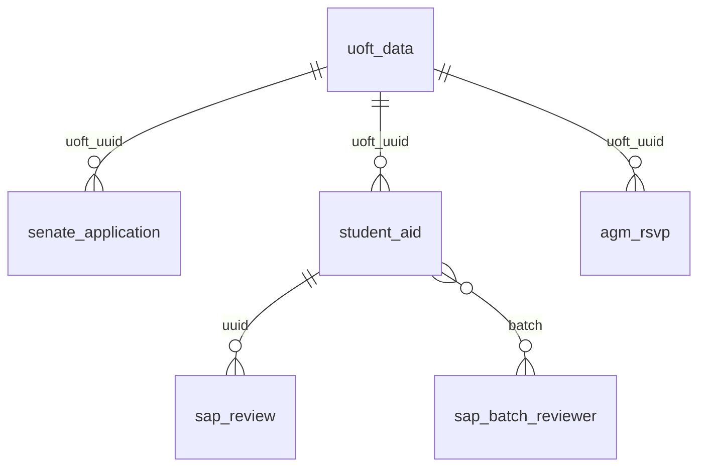

# Data Model

All data is in one SQLite file (`--db`, default `secrets/db.sqlite`). Table definitions are in `src/schema/*.sql`; tables
are created on demand and columns added by later versions are added to older databases automatically
(`add_missing_columns`). Treat the database as **private**: it holds the roster and, for SABP, student numbers.



There are no declared foreign keys; the relationships are by convention.

## `uoft_data` (roster)

Dropped and re-created by every roster import.

| Column | Notes |
|---|---|
| `uuid` | `roster:<uuid>`, derived from the cleaned row values (primary key) |
| `trunc_id` | last 4 digits of the student number (INTEGER, so leading zeros are not stored) |
| `first_name`, `last_name`, `full_name` | normalized (Title Case, ASCII) |
| `division`, `faculty` | upper-case, ASCII |
| `import_date` | timestamp |

Indexes: `idx_full_name`, `idx_trunc_id`. Required roster CSV columns: `First Name`, `Last Name`,
`Truncated Student Number`, `Faculty`, `Division`.

## Application tables (shared columns)

`senate_application`, `student_aid` and `agm_rsvp` share this tracking set:

| Column | Meaning |
|---|---|
| `uuid` | `application:<program>:<uuid>`: timestamp + student identity key (primary key) |
| `student_uuid` | `student:<key type>:<uuid>` |
| `uoft_uuid` | matching `uoft_data.uuid`, NULL when unverified |
| `verification_level` | 1 / 2 / 3 ([levels](Identity-and-Verification#verification-levels-at-a-glance)) |
| `match_method` | `name only`, `student number only`, `name + student number` |
| `status` | `verified`, `unverified`, `superseded`, `non_binding`, `not_considered` |
| `submission_ts` | the form timestamp as given |
| `source_hash` | fingerprint of the form row as processed; NULLed by `--resolve_invalid` |
| `invalid_reason` | set when a verified row was edited after processing; NULL means valid |
| `import_date` | timestamp |

## `senate_application`

Adds `delegated` (`yes`/`no`). No names or emails are stored.

## `student_aid`

Adds: `student_number` (**the number as typed on the form**, up to the full number; not NULL), `terms`, `stage`
(`scored`, `in_review`, `discuss`, `reconciled`, `decided`; NULL for unverified), `aid_type` (`LC`/`AP`),
`requested_amount`, `wfni`, `emergency`, `flags` (`;`-separated), `batch`, `record`, `awarded_amount`, `decision`.
`awarded_amount` and `decision` are set only by `--record_decisions` and never overwritten by reprocessing.

## `sap_batch_reviewer`

`(batch, reviewer)` primary key: the two committee members each batch is assigned to.

## `sap_review`

`(uuid, reviewer)` primary key with `need_level` (0-5) and `notes`; filled by `--merge_reviews`. Note the `uuid` here is
the application uuid copied from the reviewer sheet.

## `agm_rsvp`

Adds `reason`, `meeting_preference` (as given), `contact_ok` (`yes`/`no`) and `flags`. Names, emails and contact
details are **not stored**; dietary and accessibility answers are only in the output files.

## Useful queries

```sql
-- how many verified applications at each level
SELECT verification_level, COUNT(*) FROM senate_application WHERE status = 'verified' GROUP BY 1;

-- applications that are held
SELECT uuid, invalid_reason FROM student_aid WHERE invalid_reason IS NOT NULL;

-- SABP pipeline position
SELECT stage, COUNT(*) FROM student_aid WHERE status = 'verified' GROUP BY stage;

-- only student ids that were derived from an email
SELECT COUNT(DISTINCT student_uuid) FROM agm_rsvp WHERE student_uuid LIKE 'student:email:%';
```

Use a copy (or a read-only connection) for ad-hoc queries; the backups in `<db folder>/backups/` are ordinary SQLite files.
