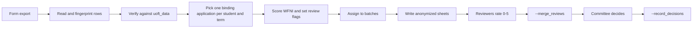

# Student Aid Bursary Program

`src/utsu_programs/sap/program.py` processes the SABP form export (Stages 1-3 of SAS-002). The financial-need scoring is in
`src/utsu_programs/sap/wfni.py`. The program verifies applicants, scores them, cuts anonymized review batches for the
committee, merges reviewer ratings, and records final decisions. **Disbursement is not tracked.**

```powershell
utsu-sap --sap_file secrets/sabp.csv [--batch_size 50] [--reviewers "Ann,Bo,Cy"]
```

## Form export

Columns are renamed through `data/conversion_table_sap.csv`. Every mapped column is required **except** the identity
columns (`Student Number`, first name, last name), of which at least one must exist. See
[Input and Output Files](Input-and-Output-Files#lookup-tables-form-column-names) for the full list.

> Known defect: if the export has **no** `Student Number` column the run currently fails when saving to the database
> (`You did not supply a value for binding parameter :id`), although name-only matching is meant to work. See
> [Code Review](Code-Review#high).

## Pipeline



### Streams, amounts and flags

| Stream | Code | Max request per term |
|---|---|---|
| Living-costs Bursary (starts with "Living") | `LC` | $2,500 ($1,500 LAB + up to $1,000 Emergency Bursary) |
| Academic Pursuits Bursary (starts with "Academic") | `AP` | $1,500 |

| Flag | Raised when |
|---|---|
| `membership_not_confirmed` | the membership confirmation is not "yes" |
| `unknown_bursary_type` | the bursary type is neither Living nor Academic |
| `no_amount` | the requested amount cannot be read, or is not a positive finite number |
| `amount_over_max` | the amount is above the stream maximum |
| `instant_approval_eligible` | the amount is under $150 (and not over the max) |
| `no_statement` | the general statement is empty |
| `wfni_incomplete` | a WFNI answer was blank or not a known option |
| `high_wfni` | WFNI is at or above the high threshold |

Emergency requests (`Emergency Bursary` among the living-costs subsidies) set the `emergency` column.

### WFNI (Weighted Financial Need Index)

Only living-costs applications that answered the questionnaire get a score. Seven questions (`disability_mobility`,
`disability_invisible`, `living_situation`, `disposable_income`, `liquidity`, `dependents`, `external_supports`) plus a
capped **circumstances** bonus (multi-select, "n/a" / "none" excluded).

- Weights are in `data/wfni_weights.csv` (`field,answer,points`). **Edit and re-run; no code change.** The file is
  re-read when it changes and its SHA-256 is saved in `sap_run.json` (`wfni_weights_sha256`).
- Answers are matched to the form's option text **exactly**, ignoring case, spacing and "to" vs "-". Only an answer
  written with a trailing `*` in the weights file matches by its start (the long option is `A negative amount*`). Any
  other answer is unknown and flags `wfni_incomplete`. `circumstances` has two rows: `per_answer` and `cap`.
- Maximum score = sum of each question's highest answer + the circumstances cap. `high_wfni` is raised at
  `max // 2 + 1` (with the shipped weights: max 33, threshold 17).
- Every run recomputes `wfni` for every application in the export with the current weights, so editing the weights
  changes the next run's scores. Review sheets already handed out keep their old score.

## Batches and anonymization

- Verified, binding applications are cut into batches of at most `--batch_size` (default 50), **oldest
  submission first**. A record id looks like `B001-07` (batch 1, record 7).
- Committee-facing files carry only the application `uuid` and the record id. Names, emails, phone numbers, student
  numbers, postal codes, links and the applicant's own name are redacted from free text (`[name]`, `[email]`, `[phone]`,
  `[student number]`, `[postal code]`, `[link]`). A name is found however it is spelled (accents, case) and names of two
  letters count too. Faculty is left out.
- New applications start a new batch once the last one is full or has been assigned to reviewers, otherwise they top
  it up. Slots of superseded applications are never reused.

### Reviewer sheets

With `--reviewers "Ann,Bo,Cy"` (two or more names) each batch is assigned to **two** reviewers, least loaded first,
saved in `sap_batch_reviewer`. Existing batches keep their reviewers when more are added. Reviewer names are
sanitized for folder names (`Ann Lee` → `Ann_Lee`).

```
<output_dir>/sap_batches/
    batch_001.csv / .txt                  blank sheets (replaced on re-run until the batch is closed)
    by_reviewer/<name>/batch_001.csv/.txt each reviewer's own copy; never overwritten
```

The reviewer fills in `need_level` (0-5, per the General Statement Rubric) and `notes` in the `.csv` and returns the file
to the **same place**. If a batch changed since it was issued (for example the last partial batch grew), a warning says
so and the merge reports the missing ratings. A batch whose reviewers were assigned or which was marked as issued is
**closed**: its blank sheets are no longer rewritten and it is never added to.

If sheets are handed out without `--reviewers`, record that with `--issue_batches all` (or `1,2`).

## Merging reviews

```powershell
utsu-sap --merge_reviews
```

Writes `sap_merged_ratings.csv` and fills the `sap_review` table. Per application: reviewers, each rating, the mean, the
spread, a `suggested_amount` and a `status`:

| `status` | Meaning |
|---|---|
| `agreed` | two ratings, levels differ by less than 2 |
| `discuss` | two ratings, levels differ by 2 or more |
| `incomplete` | only one rating |
| `unrated` | no rating |

`suggested_amount` = mean of the rubric maxima for the levels given, capped at the amount requested.

| Need level | 0 | 1 | 2 | 3 | 4 | 5 |
|---|---|---|---|---|---|---|
| Rubric maximum | $0 | $125 | $300 | $650 | $900 | $1,500 |

Invalid levels (not an integer 0-5) and unknown applications are logged as warnings. Only the reviewers assigned to a
batch count: a stray folder under `by_reviewer/` is reported and its ratings ignored. A rating that is blanked in a sheet
is removed from `sap_review` on the next merge.

## Stages and decisions

Every verified application has a `stage` in `student_aid` (empty for unverified ones). The program only moves it
forward; reprocessing never moves it back.

| Stage | Set when |
|---|---|
| `scored` | verified and scored, in a batch not yet handed out |
| `in_review` | its batch is handed to reviewers (`--reviewers` assigned, or `--issue_batches`) |
| `discuss` / `reconciled` | `--merge_reviews` finds the two levels 2+ apart / in agreement (one rating stays `in_review`) |
| `decided` | `--record_decisions decisions.csv` |

```powershell
utsu-sap --issue_batches all      # sheets were handed out without --reviewers
utsu-sap --merge_reviews
utsu-sap --record_decisions decisions.csv
```

`decisions.csv` needs `uuid` and `decision`; `awarded_amount` is optional (`0` is allowed). Other columns (for example
those of `sap_merged_ratings.csv`) are ignored, so the merged file can be filled in and used directly. Rows that cannot be
recorded are listed and skipped: unknown application, unverified, missing decision, bad amount. A
decision recorded before reconciliation is accepted with a warning (for example instant approvals). Recording an
application again replaces its decision, with a warning; the same decision again with no amount keeps the stored amount.

Sheets that come back as `.docx` in one folder per reviewer, possibly from batches that no longer match the database,
can be merged on their own (no database; the folder name is the reviewer, `[B012-01]` tags identify records, and a score
such as `2-3` becomes `2.5`). `suggested_amount` is the mean score on an exponential curve,
`a * (exp(k * score) - 1)`, fitted (least squares, through $0 at level 0) to the rubric maximums so that fractional
scores get an amount, rounded to the nearest $10 and never below `rubric_amount`, the rubric maximum of the mean
score's whole level (for example a mean of 3 is at least $650, even though the curve gives $583):

```powershell
python -m utsu_programs.sap.merge_docx path\to\reviewers -o secrets\merged_reviews.csv
```

### Private banking export

Join the merged reviews with the **same database used to assign their batches** and the original full SABP form
export:

```powershell
python -m utsu_programs.sap.export_banking secrets\merged_reviews.csv secrets\sabp.csv secrets\data.sqlite -o secrets\reviews_banking.csv
```

The export preserves the review columns and adds the application UUID, first and last names, email, original email,
institution name, institution number, transit number, account number and `export_flags`. The record ID resolves to
one database application, whose UUID is recomputed from the original form row using the normal SABP rules. Missing or
ambiguous matches, duplicate records and missing required columns stop the export without replacing the output. The
database is read-only. Verify that the database really corresponds to the review sheets: the same record ID can be
assigned to a different person in a different database. Applications absent from the form export cannot be recovered
from the database alone.

Valid emails are converted to `@mail.utoronto.ca`, including addresses on other domains; `email_changed` flags any
change and `original_email` retains the source. **Confirm changed addresses before use:** converting a personal or
other U of T address does not establish that the resulting mailbox exists or belongs to the student. The
`email_domain_similarity` score (0 to 1) compares the original domain to `utoronto.ca` and `mail.utoronto.ca`, taking
the higher score; for example `toronto.ca` is treated as a likely typo. A score below 0.8 is additionally flagged
`email_low_domain_similarity`. The score is a heuristic, not evidence that the address belongs to the student.
Invalid or blank emails are left blank and marked `invalid_email`. `missing_bank_information` flags blank banking
fields; the script does not validate account numbers. Bank numbers remain strings in the CSV, but spreadsheet
programs can remove leading zeroes when opening it: import these columns as text.

This file contains highly sensitive banking and identifying information. Store it in `secrets`, restrict access, and
never distribute it with anonymized reviewer sheets.

`decided` is the last stage: the application is **complete**, which makes it final for that term (any other
application of the student for that term becomes `not_considered`). `sap_run.json` counts verified applications per
stage. Databases from before the `stage` column get it filled in on the next run (`decided` if there is a decision,
`in_review` if the batch has reviewers, else `scored`).

## Outputs (in `--output_dir`)

| File | Contents |
|---|---|
| `sap_verified.csv` | **Private.** Master list of verified binding applications: `uuid, status, student_uuid, uoft_uuid, verification_level, match_method, submission_ts, terms, id, full_name, email, faculty, stream, subsidies, requested_amount, wfni, emergency, flags, batch, record` |
| `sap_unverified.csv` | **Private.** Same columns for unverified binding applications |
| `sap_batches/` | Anonymized sheets (above) |
| `sap_merged_ratings.csv` | Created by `--merge_reviews` |
| `alerts_sap.csv` | Duplicate / roster-mismatch / missing-from-export / overlapping-terms / non-binding / not-considered |
| `sap_run.json` | Counts: submissions, binding, verified, unverified, alerts, duplicates, non-binding, not considered, `missing_from_export`, `kept_verified_despite_roster`, `stages`, `wfni_weights_sha256`, `batches`, `batch_size`, `reviewers`, `emergency`, `flags` |

Database tables for SABP are described in [Data Model](Data-Model#student_aid).
