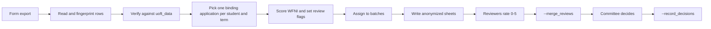

# Student Aid Bursary Program

`src/utsu_core/sap.py` processes the SABP form export (Stages 1-3 of SAS-002). The financial-need scoring is in
`src/utsu_core/wfni.py`. The program verifies applicants, scores them, cuts anonymized review batches for the
committee, merges reviewer ratings, and records final decisions. **Disbursement is not tracked.**

```powershell
python -m utsu_core.main --program sap --sap_file secrets/sabp.csv [--batch_size 50] [--reviewers "Ann,Bo,Cy"]
```

## Form export

Columns are renamed through `data/conversion_table_sap.csv`. Every mapped column is required **except** the identity
columns (`Student Number`, first name, last name), of which at least one must exist. See
[Input and Output Files](Input-and-Output-Files#lookup-tables-form-column-names) for the full list.

> Known defect: if the export has **no** `Student Number` column the run currently fails when saving to the database
> (`You did not supply a value for binding parameter :id`), although name-only matching is meant to work. See
> [Code Review](Code-Review#high).

## Pipeline



### Streams, amounts and flags

| Stream | Code | Max request per term |
|---|---|---|
| Living-costs Bursary (starts with "Living") | `LC` | $2,500 ($1,500 LAB + up to $1,000 Emergency Bursary) |
| Academic Pursuits Bursary (starts with "Academic") | `AP` | $1,500 |

| Flag | Raised when |
|---|---|
| `membership_not_confirmed` | the membership confirmation is not "yes" |
| `unknown_bursary_type` | the bursary type is neither Living nor Academic |
| `no_amount` | the requested amount cannot be read |
| `amount_over_max` | the amount is above the stream maximum |
| `instant_approval_eligible` | the amount is under $150 (and not over the max) |
| `no_statement` | the general statement is empty |
| `wfni_incomplete` | a WFNI answer was blank or not a known option |
| `high_wfni` | WFNI is at or above the high threshold |

Emergency requests (`Emergency Bursary` among the living-costs subsidies) set the `emergency` column.

### WFNI (Weighted Financial Need Index)

Only living-costs applications that answered the questionnaire get a score. Seven questions (`disability_mobility`,
`disability_invisible`, `living_situation`, `disposable_income`, `liquidity`, `dependents`, `external_supports`) plus a
capped **circumstances** bonus (multi-select, "n/a" / "none" excluded).

- Weights are in `data/wfni_weights.csv` (`field,answer,points`). **Edit and re-run; no code change.** The file is
  re-read when it changes and its SHA-256 is saved in `sap_run.json` (`wfni_weights_sha256`).
- Answers are matched to the form's option text, ignoring case, spacing and "to" vs "-". `circumstances` has two rows:
  `per_answer` and `cap`.
- Maximum score = sum of each question's highest answer + the circumstances cap. `high_wfni` is raised at
  `max // 2 + 1` (with the shipped weights: max 33, threshold 17).
- A re-run recomputes `wfni` for every application, but review sheets already handed out keep their old score.

> Matching is documented as exact (the long "A negative amount (...)" option aside), but the current implementation
> falls back to a **prefix match for every question**, so an unlisted answer that merely *starts with* a listed one
> (for example "None of the above" vs. "No") is scored silently instead of flagging `wfni_incomplete`. See
> [Code Review](Code-Review#medium).

## Batches and anonymization

- Verified, binding, non-held applications are cut into batches of at most `--batch_size` (default 50), **oldest
  submission first**. A record id looks like `B001-07` (batch 1, record 7).
- Committee-facing files carry only the application `uuid` and the record id. Names, emails, phone numbers, student
  numbers, postal codes, links and the applicant's own name are redacted from free text (`[name]`, `[email]`, `[phone]`,
  `[student number]`, `[postal code]`, `[link]`). Faculty is left out.
- New applications start a new batch once the last one is full or has been assigned to reviewers, otherwise they top
  it up. Slots of superseded applications are never reused.

### Reviewer sheets

With `--reviewers "Ann,Bo,Cy"` (two or more names) each batch is assigned to **two** reviewers, least loaded first,
saved in `sap_batch_reviewer`. Existing batches keep their reviewers when more are added. Reviewer names are
sanitized for folder names (`Ann Lee` → `Ann_Lee`).

```
<output_dir>/sap_batches/
    batch_001.csv / .txt                  blank sheets (replaced on re-run until the batch is closed)
    by_reviewer/<name>/batch_001.csv/.txt each reviewer's own copy; never overwritten
```

The reviewer fills in `need_level` (0-5, per the General Statement Rubric) and `notes` in the `.csv` and returns the file
to the **same place**. If a batch changed since it was issued (for example the last partial batch grew), a warning says
so and the merge reports the missing ratings. A batch whose reviewers were assigned or which was marked as issued is
**closed**: its blank sheets are no longer rewritten and it is never added to.

If sheets are handed out without `--reviewers`, record that with `--issue_batches all` (or `1,2`).

## Merging reviews

```powershell
python -m utsu_core.main --program sap --merge_reviews
```

Writes `sap_merged_ratings.csv` and fills the `sap_review` table. Per application: reviewers, each rating, the mean, the
spread, a `suggested_amount` and a `status`:

| `status` | Meaning |
|---|---|
| `agreed` | two ratings, levels differ by less than 2 |
| `discuss` | two ratings, levels differ by 2 or more |
| `incomplete` | only one rating |
| `unrated` | no rating |

`suggested_amount` = mean of the rubric maxima for the levels given, capped at the amount requested.

| Need level | 0 | 1 | 2 | 3 | 4 | 5 |
|---|---|---|---|---|---|---|
| Rubric maximum | $0 | $125 | $300 | $650 | $900 | $1,500 |

Invalid levels (not an integer 0-5) and unknown applications are logged as warnings. Held applications' ratings are
ignored.

## Stages and decisions

Every verified application has a `stage` in `student_aid` (empty for unverified ones). The program only moves it
forward; reprocessing never moves it back.

| Stage | Set when |
|---|---|
| `scored` | verified and scored, in a batch not yet handed out |
| `in_review` | its batch is handed to reviewers (`--reviewers` assigned, or `--issue_batches`) |
| `discuss` / `reconciled` | `--merge_reviews` finds the two levels 2+ apart / in agreement (one rating stays `in_review`) |
| `decided` | `--record_decisions decisions.csv` |

```powershell
python -m utsu_core.main --program sap --issue_batches all      # sheets were handed out without --reviewers
python -m utsu_core.main --program sap --merge_reviews
python -m utsu_core.main --program sap --record_decisions decisions.csv
```

`decisions.csv` needs `uuid` and `decision`; `awarded_amount` is optional. Other columns (for example those of
`sap_merged_ratings.csv`) are ignored, so the merged file can be filled in and used directly. Rows that cannot be
recorded are listed and skipped: unknown application, unverified, held (invalid), missing decision, bad amount. A
decision recorded before reconciliation is accepted with a warning (for example instant approvals).

`decided` is the last stage: the application is **complete**, which makes it final for that term (any other
application of the student for that term becomes `not_considered`). `sap_run.json` counts verified applications per
stage. Databases from before the `stage` column get it filled in on the next run (`decided` if there is a decision,
`in_review` if the batch has reviewers, else `scored`).

## Outputs (in `--output_dir`)

| File | Contents |
|---|---|
| `sap_verified.csv` | **Private.** Master list of verified binding applications: `uuid, status, invalid_reason, student_uuid, uoft_uuid, verification_level, match_method, submission_ts, terms, id, full_name, email, faculty, stream, subsidies, requested_amount, wfni, emergency, flags, batch, record` |
| `sap_unverified.csv` | **Private.** Same columns for unverified binding applications |
| `sap_batches/` | Anonymized sheets (above) |
| `sap_merged_ratings.csv` | Created by `--merge_reviews` |
| `alerts_sap.csv` | Held / duplicate / non-binding / not-considered |
| `sap_run.json` | Counts: submissions, new, processed, binding, verified, unverified, changed, held, alerts, duplicates, non-binding, not considered, `stages`, `wfni_weights_sha256`, `batches`, `batch_size`, `reviewers`, `emergency`, `flags` |

Database tables for SABP are described in [Data Model](Data-Model#student_aid).
